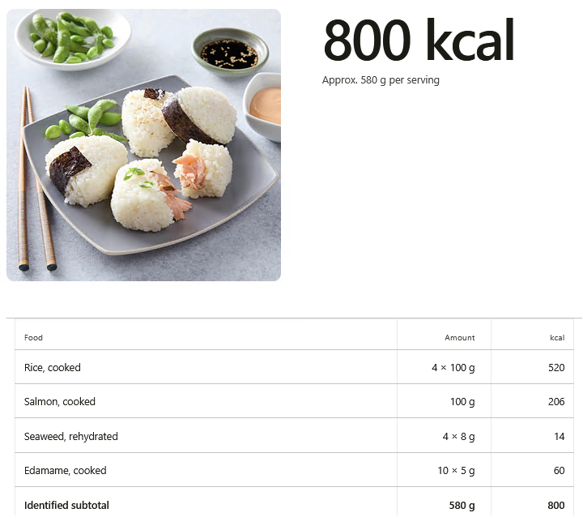

# FoodCalories 🍽️

**Estimate meal calories from a photograph using AI and Python.**

Upload a food photograph and FoodCalories identifies likely ingredients, estimates their quantities and calculates approximate calories.

Built with Python, Streamlit and a local AI vision model.



## ✨ What does it do?

1. Upload or paste a photograph of food.
2. AI identifies the probable dish and ingredients.
3. Python matches ingredients with a nutritional database.
4. The application calculates and displays approximate calories.

No manual ingredient entry is required.

## 🧠 How does it work?

```text
        📷 Food photograph
                |
                v
         AI Vision Model
         (Ollama + Qwen)
                |
                v
       Recognised ingredients
       (structured JSON data)
                |
                v
        Python + foods.csv
        (calorie calculation)
                |
                v
       🖥️ Streamlit results
```

**AI recognises the food. Python calculates the calories.**

This is an important distinction: the application's final calorie calculation uses nutritional reference values, not an arbitrary calorie number generated by AI.

## 💻 Hardware requirements

FoodCalories runs a **local** AI vision model on your computer (through Ollama). The default model is about **3.3 GB** to download, and inference uses additional memory while analysing a photograph.

Guidance for classroom MacBooks:

| Total memory | Expectation |
|---|---|
| Less than 8 GB | Prefer a PolyU laboratory PC |
| 8 GB | May work, but can be slow or memory-heavy |
| 16 GB or more | Usually more comfortable, still depends on free memory |

Actual suitability depends on **available** memory, other open apps, disk space and CPU/GPU support — not only the RAM figure on the laptop lid.

If setup or launch reports a hardware warning, use a **PolyU laboratory PC with the prepared AI environment** for the class exercise.

## 🚀 Getting started

**1. Download the project**

Open a terminal and run:

```bash
git clone https://github.com/marco-bettoni/FoodCalories.git
cd FoodCalories
```

**2. Install the application**

### Windows

```bat
setup.bat
```

If Ollama and the model are already installed:

```bat
setup.bat --skip-model
```

You need Python 3.11 or 3.12, Git, Ollama and the `qwen3-vl:4b-instruct` model. In the PolyU laboratory these may already be installed.

### macOS / Linux

```bash
chmod +x setup.sh run.sh scripts/check_system.sh
./setup.sh
```

Optional checks and shortcuts:

```bash
# Hardware summary only (no install)
./scripts/check_system.sh

# Python packages only — skip Ollama model download
./setup.sh --skip-model

# Confirm the ~3.3 GB model download without an interactive prompt
./setup.sh --yes
```

`setup.sh` prints a short system check, creates `.venv`, installs dependencies, and asks before downloading the AI model (~3.3 GB).

**3. Launch FoodCalories**

Windows:

```bat
run.bat
```

macOS / Linux:

```bash
./run.sh
```

Open the local Streamlit address displayed in the terminal (normally `http://localhost:8501`).

**4. Try a meal photograph**

Upload or paste an image and observe the recognised ingredients and estimated calories.

Example photographs for practice are in `samples/verify/`.

## 🐍 Explore the Python code

The important files are:

| File | What it does |
|---|---|
| `app.py` | Creates the website and displays the results |
| `vision.py` | Communicates with the AI model and interprets its response |
| `nutrition.py` | Matches ingredients and calculates calories |
| `foods.csv` | Stores food names and calories per 100 g |
| `images.py` | Prepares photographs for AI analysis |
| `cache.py` | Reuses previous AI results |
| `config.py` | Stores application settings |

You do not need to understand every line of code.

Start with the basic calorie calculation:

```python
def calculate_calories(grams, kcal_per_100g):
    return grams * kcal_per_100g / 100

print(calculate_calories(150, 130))
```

Result:

```text
195.0
```

This calculates 195 kcal for 150 g of a food containing 130 kcal per 100 g.

## 🤖 Learn with an AI coding assistant

During the course, you will learn how to:

- Understand basic Python variables, lists, loops and functions.
- Read and modify an existing Python project.
- Use Cline to explain and change Python code.
- Add a new feature through prompting.
- Test whether the modified application works correctly.

The objective is to understand the application and verify AI-generated changes, not simply accept every suggestion from an AI assistant.

## 🧪 Run the tests

From the project folder, with the Python environment activated:

```bash
python -m pytest -q
```

On Windows with the project virtual environment:

```bat
.venv\Scripts\python.exe -m pytest -q
```

On macOS / Linux with the project virtual environment:

```bash
.venv/bin/python -m pytest -q
```

Tests help verify that important functionality continues working after code changes.

## ⚠️ Important limitations

FoodCalories provides **approximate estimates**, not precise nutritional measurements.

Photographs cannot reliably reveal exact ingredient weights, cooking oil, hidden ingredients or preparation methods.

Important foods may not be recognised or matched, so the displayed calorie estimate can be too low.

Do not use the results for medical decisions or allergy-safety assessments.

## 🎓 Educational project

Developed for the course *Introduction to AI with Python and Prompting* at The Hong Kong Polytechnic University, Industrial Centre.

The project demonstrates how Python and AI can work together to create a practical application.
